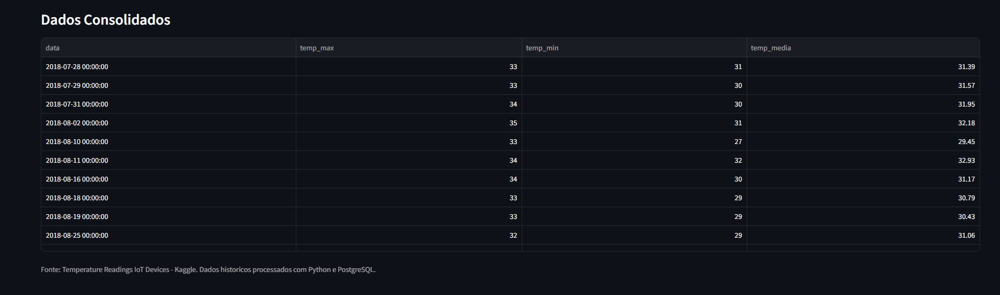
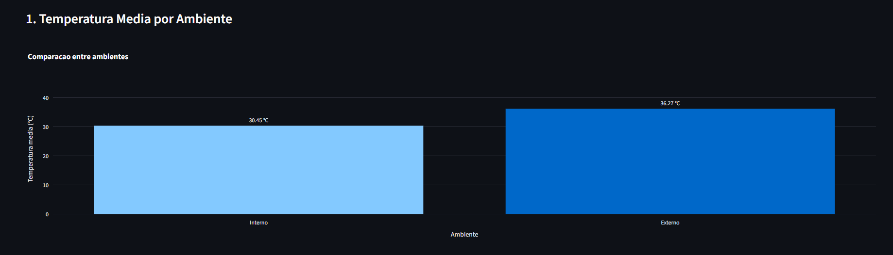
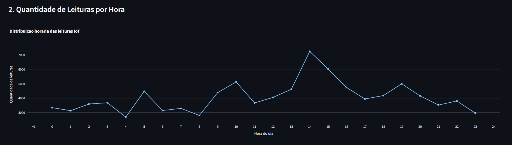
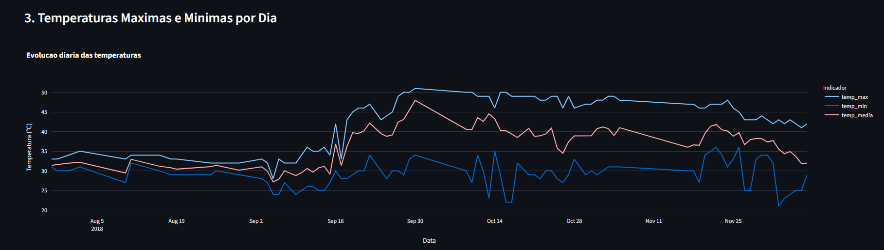

# 🌡️ Pipeline de Dados IoT com Docker e PostgreSQL

## 📋 Sobre o Projeto

Projeto desenvolvido para a disciplina **Disruptive Architectures: IoT, Big Data e IA**.

O objetivo é implementar um pipeline de dados capaz de processar leituras de temperatura de dispositivos IoT, armazená-las em um banco PostgreSQL executado no Docker e visualizar informações por meio de um dashboard interativo desenvolvido com Streamlit e Plotly.

O projeto utiliza dados históricos reais disponibilizados pelo Kaggle.

## 🛠️ Tecnologias Utilizadas

- Python 3.13 — Processamento e integração
- Pandas — Limpeza e transformação dos dados
- SQLAlchemy — Conexão com o PostgreSQL
- PostgreSQL 16 — Armazenamento e consultas SQL
- Docker e Docker Compose — Contêiner do banco
- Streamlit — Interface do dashboard
- Plotly — Gráficos interativos
- Git e GitHub — Versionamento e documentação

## 🏗️ Arquitetura do Pipeline

```text
Dataset IoT (Kaggle)
        |
        v
Arquivo CSV
        |
        v
Python + Pandas
        |
        v
Limpeza e transformação
        |
        v
SQLAlchemy
        |
        v
PostgreSQL (Docker)
        |
        v
Três Views SQL
        |
        v
Streamlit + Plotly
        |
        v
Dashboard IoT
```

O processamento utiliza uma carga em lote dos dados históricos.

## 📁 Estrutura do Projeto

```text
Projeto/
├── data/
│   └── IOT-temp.csv
├── docs/
│   └── screenshots/
│       ├── dashboard_indicadores.png
│       ├── grafico_temperatura_media.png
│       ├── grafico_leituras_hora.png
│       └── grafico_temperaturas_diarias.png
├── sql/
│   └── views.sql
├── src/
│   ├── pipeline.py
│   └── dashboard.py
├── docker-compose.yml
├── requirements.txt
├── .env.example
├── .gitignore
└── README.md
```

O arquivo `.env` e o ambiente virtual `.venv` são locais e não devem ser publicados no GitHub.

O CSV original também não é versionado, mas pode ser obtido gratuitamente no Kaggle.

## 📊 Base de Dados

**Nome:** Temperature Readings: IoT Devices

**Fonte:** Kaggle

**Link:**
https://www.kaggle.com/datasets/atulanandjha/temperature-readings-iot-devices

O conjunto contém 97.606 registros originais, com as seguintes colunas:

| Coluna | Descrição |
|---|---|
| id | Identificador da leitura |
| room_id/id | Identificação do ambiente |
| noted_date | Data e hora do registro |
| temp | Temperatura |
| out/in | Sensor interno ou externo |

Durante o processamento, um registro foi descartado, resultando em 97.605 leituras válidas.

## 🚀 Como Executar

### 1. Pré-requisitos

Instalar:

- Python 3.13
- Git
- Docker Desktop com WSL 2

### 2. Obter o projeto

```powershell
git clone URL_DO_REPOSITORIO
cd NOME_DO_REPOSITORIO
```

Substituir a URL pelo endereço real do GitHub.

### 3. Criar o ambiente virtual

```powershell
python -m venv .venv
.\.venv\Scripts\Activate.ps1
```

### 4. Instalar as dependências

```powershell
python -m pip install -r requirements.txt
```

### 5. Configurar o banco de dados

Criar o arquivo `.env` a partir do exemplo:

```powershell
Copy-Item .env.example .env
```

Verificar as credenciais no arquivo `.env`.

As credenciais do Docker Compose são demonstrativas e destinadas exclusivamente ao desenvolvimento local.

### 6. Iniciar o PostgreSQL

Com o Docker Desktop funcionando:

```powershell
docker compose up -d
```

Verificar:

```powershell
docker ps
```

### 7. Baixar o dataset

Baixar `IOT-temp.csv` no Kaggle e colocá-lo na pasta `data/`.

### 8. Executar o pipeline

```powershell
python src/pipeline.py
```

O programa realiza:

1. Leitura do CSV.
2. Padronização dos nomes das colunas.
3. Conversão das datas e temperaturas.
4. Remoção de registros inválidos e duplicados.
5. Inserção das leituras no PostgreSQL.
6. Verificação da quantidade de registros.

O pipeline substitui os registros existentes a cada carga, sem duplicar as leituras já processadas.

### 9. Criar as Views SQL

```powershell
Get-Content -Raw -Encoding UTF8 .\sql\views.sql | docker exec -i postgres-iot psql -U iot_user -d iot_db -v ON_ERROR_STOP=1
```

### 10. Executar o Dashboard

```powershell
python -m streamlit run src/dashboard.py
```

Abrir no navegador:

http://localhost:8501

## 🗄️ Views SQL

### View 1 — avg_temp_por_dispositivo

Calcula a temperatura média e a quantidade de leituras por tipo de ambiente.

Permite comparar as condições internas e externas.

**Resultados:**

- Interno: 30,45 °C
- Externo: 36,27 °C

### View 2 — leituras_por_hora

Agrupa as leituras pela hora do dia e calcula a quantidade de registros.

Permite identificar períodos com maior ou menor volume de medições.

**Resultados:**

- Maior volume: 14h, com 7.248 leituras
- Menor volume: 4h, com 2.690 leituras

### View 3 — temp_max_min_por_dia

Agrupa os dados por data e calcula:

- Temperatura máxima
- Temperatura mínima
- Temperatura média

Permite identificar variações térmicas e possíveis situações de aquecimento elevado.

## 📈 Dashboard

### Indicadores e visão geral



### Gráfico 1 — Temperatura Média por Ambiente



### Gráfico 2 — Leituras por Hora



### Gráfico 3 — Temperaturas por Dia



## 💡 Insights Obtidos

A análise dos dados permitiu identificar:

1. A temperatura média externa foi 5,82 °C superior à interna.
2. O maior volume de registros ocorreu às 14h.
3. Existem variações significativas nas temperaturas máximas e mínimas ao longo do período analisado.
4. O conjunto apresenta mais registros externos do que internos.

Esses resultados podem auxiliar em aplicações de monitoramento ambiental, gestão de climatização e análise de comportamento térmico.

O dataset é histórico e não representa medições em tempo real.

## 🔧 Comandos Git Utilizados

Inicializar o repositório:

```powershell
git init
```

Adicionar arquivos:

```powershell
git add .
```

Criar commit:

```powershell
git commit -m "Projeto inicial: Pipeline de Dados IoT"
```

Associar o repositório remoto:

```powershell
git remote add origin URL_DO_REPOSITORIO
```

Enviar o projeto:

```powershell
git push -u origin main
```

Atualizar o repositório local:

```powershell
git pull
```

## 🎯 Conclusão

O projeto demonstrou a integração entre Python, Docker, PostgreSQL e Streamlit para construir um pipeline completo de processamento e visualização de dados IoT.

A solução permite transformar registros históricos de sensores em informações úteis, facilitando análises e decisões baseadas em dados.

A arquitetura também pode servir de base para futuras implementações com ingestão contínua de dados e monitoramento em tempo real.

## 📚 Referências

- Kaggle: https://www.kaggle.com/
- Python: https://www.python.org/
- Docker: https://docs.docker.com/
- PostgreSQL: https://www.postgresql.org/
- Streamlit: https://docs.streamlit.io/
- Plotly: https://plotly.com/python/
- SQLAlchemy: https://www.sqlalchemy.org/
